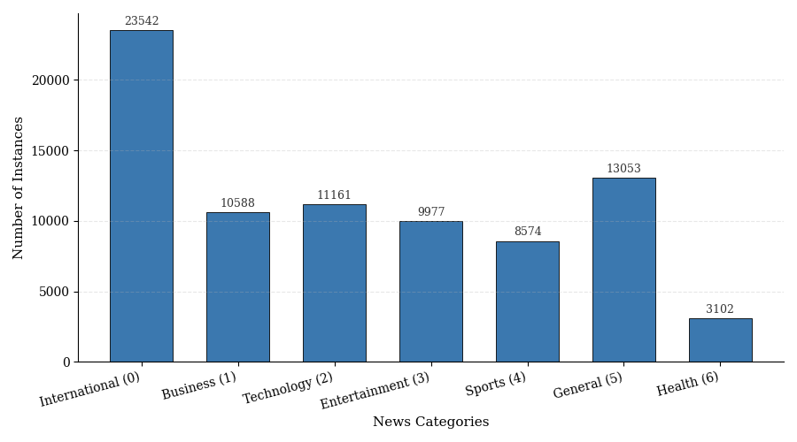
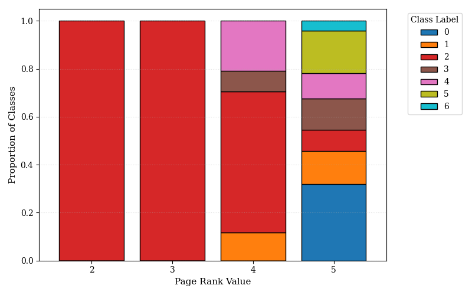
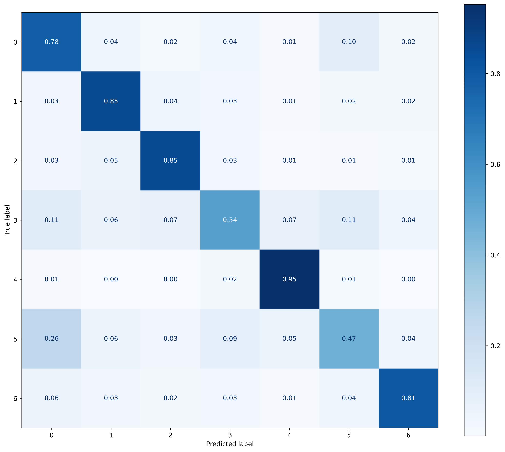

# News Topic Classification from Text and Metadata

Multiclass classification of ~100k online news articles into 7 topics, combining TF-IDF text features with engineered metadata features and a linear SVM.

Project for the **Data Science and Machine Learning Lab** course at Politecnico di Torino (Winter call, A.Y. 2025/2026).
Full write-up: [`report/Report.pdf`](report/Report.pdf).

| Model | Stratified 5-fold CV (Macro-F1) | Public leaderboard (Macro-F1) |
|---|---|---|
| Naive baseline (TF-IDF + Multinomial NB) | – | 0.458 |
| Logistic Regression | 0.7293 | 0.727 |
| **Linear SVM (final)** | **0.7334** | **0.733** |

The full pipeline trains and predicts in about a minute on a laptop CPU.

## Problem

Each article has a `source`, `title`, `article` body, `page_rank` and `timestamp`, and must be assigned one of 7 labels:

| 0 | 1 | 2 | 3 | 4 | 5 | 6 |
|---|---|---|---|---|---|---|
| International News | Business | Technology | Entertainment | Sports | General News | Health |

The development set has 79,997 labelled articles, the evaluation set 20,000 unlabelled ones. Classes are imbalanced, so the metric is **Macro-F1**.

<p align="center"></p>

## Approach

**Cleaning.** Non-standard nulls (`\N`, `0000-00-00 00:00:00`, double spaces) are mapped to NaN at load time. Text is lowercased and HTML-unescaped; HTML/URL delimiters (`< > / = _ …`) are replaced with spaces instead of stripping tags, so words hidden in URLs (e.g. `.../politics/...`) survive. Digits become a `NUM` token and technical noise (`http`, `href`, `jpg`, single characters) is dropped.

**Deduplication.** Duplicates are grouped first by title+article, then by article only. Each group collapses to one row with its majority label; groups with a tie are discarded. The training set goes from 79,997 to about 74k rows.

**Features.**
- *Text*: TF-IDF on title+article with uni/bi/trigrams, sublinear TF, English stop words, `min_df=2`, `max_df=0.5`.
- *PageRank*: one-hot encoded, because specific values map to specific classes rather than following a monotonic trend.
- *Source*: 1,340 distinct publishers; the 150 most frequent are one-hot encoded and the rest grouped as "infrequent" (cut-off chosen by a sensitivity analysis).
- *Timestamp*: cyclical hour encoding (`sin`/`cos`), an `is_weekend` flag and a `timestamp_missing` flag (missing timestamps are themselves informative).

<p align="center"></p>

**Models.** Linear SVM and Logistic Regression, both with `class_weight="balanced"`, tuned with grid search under stratified 5-fold CV. Best SVM: `C=0.3`. Best Logistic Regression: `C=3`, `solver=saga`.

## Results

<p align="center"></p>

Sports, Business and Technology are recognised well (recall 0.85–0.95). The hardest classes are **General News** (recall 0.47, often predicted as International) and **Entertainment** (0.54), whose content genuinely overlaps with the other categories. CV and public scores match, so the model does not overfit the development set.

## Repository structure

```
├── src/main.py                    # final pipeline: CV score + submission.csv
├── notebooks/
│   ├── eda.ipynb                  # exploratory analysis and figures
│   ├── experiments.ipynb          # grid searches, sensitivity analyses, model comparison
│   └── naive_baseline.ipynb       # TF-IDF + Multinomial NB baseline
├── figures/                       # plots used in the report
├── report/Report.pdf              # project report
├── data/                          # dataset goes here (not versioned)
└── requirements.txt
```

## How to run

```bash
pip install -r requirements.txt
# put development.csv and evaluation.csv in data/ (see data/README.md)
python src/main.py
```

The script prints the 5-fold CV Macro-F1, trains on the whole development set and writes `submission.csv` in the repository root.

## Authors

- Fabio Stradiotti
- Giovanni Indiano
